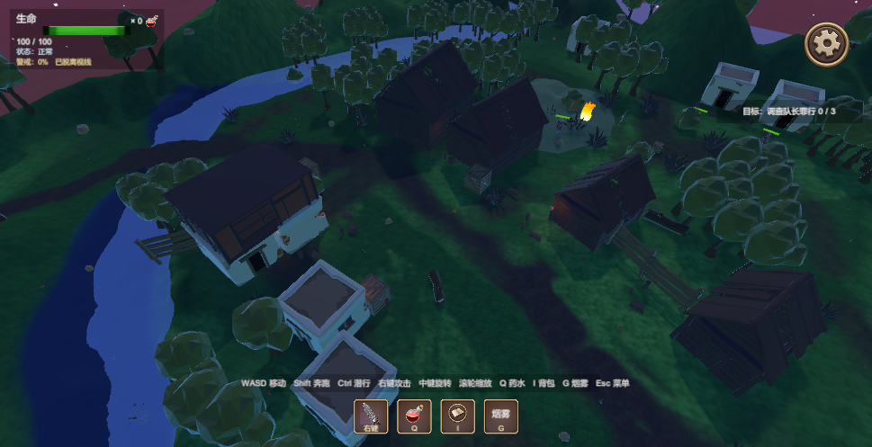
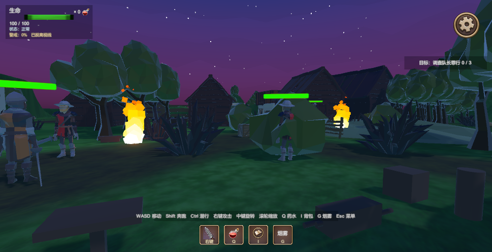
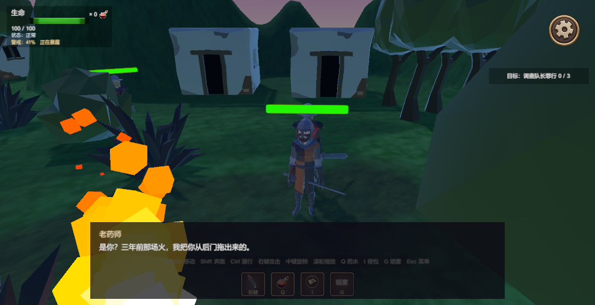
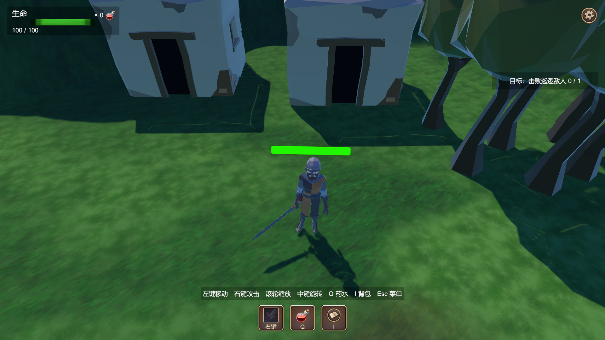

# 影村 · Shade Hamlet（RPG_Project）

第三人称 3D **潜行动作 RPG** 原型：直接操控、近战 / 弓箭、刺杀、卫兵感知、道具背包，以及带多结局的剧情章节。

| 项目 | 说明 |
| --- | --- |
| 引擎 | 团结引擎 1.8.3（Unity 2022.3.62t5 内核） |
| 语言 | C# |
| 代码规模 | 约 80 个 C# 脚本（玩法、UI、剧情、测试） |
| 运行方式 | 编辑器内 Play（未发布可执行包） |

## 实机截图









## 已实现系统

- **角色控制**：WASD 直接移动、Shift 奔跑、Ctrl 潜行、CharacterController 碰撞与重力、斜向速度归一、相机中键旋转与滚轮缩放、简单遮挡处理。
- **战斗**：近战连击与 Root Motion、攻击盒去重、仇恨与追击、弓箭手与箭矢、伤害弹字、命中 / 击杀粒子反馈、主角死亡与重开。
- **刺杀与潜行**：近距刺杀判定、卫兵视觉 / 听觉感知与警戒值、脱离视线衰减、烟雾弹干扰。
- **道具**：药水使用与满血 / 空库存 / 死亡不消耗、敌人单次掉落、碰撞拾取入库、简化背包界面。
- **剧情章节**：第一章《回村的人》——开场字幕 → 老药师对话 → 家书取证 → 兵营偷听 → 队长井边忏悔 → 近距对峙 → 杀 / 放抉择，共三种结局走向，并留下一章钩子。
- **剧情运行时**：剧情资产（`Assets/Story/`）、`StoryDirector` 状态机、内存检查点、字幕 / 对话 / 结局面板、NPC 交互、线索拾取与偷听区域。
- **界面**：生命与状态 HUD、目标提示、动作栏、背包、暂停菜单、开始界面、死亡面板，1920×1080 与默认分辨率适配。

## 操作说明

| 按键 | 效果 |
| --- | --- |
| WASD / Shift / Ctrl | 移动 / 奔跑 / 潜行 |
| 鼠标右键 | 攻击 |
| 鼠标中键 / 滚轮 | 旋转相机 / 缩放 |
| Q / I / G | 使用药水 / 背包 / 烟雾弹 |
| E | 对话、查看线索、刺杀等交互 |
| Esc | 暂停菜单（优先关闭背包） |

## 快速开始

1. 用团结引擎 Hub 安装 **2022.3.62t5 / Tuanjie 1.8.3**。
2. 在 Hub 中 Open 本目录，等待首次资源导入（`Library/` 由引擎自动生成）。
3. 打开 `Assets/Scenes/界面.scene` 进入开始界面并 Play；也可直接打开 `Assets/Scenes/RPG游戏.unity` 进入关卡。

## 目录结构

```
Assets/
  Script/      玩法、UI、剧情、AI 等 C# 代码
  Story/       剧情资产（章节、对话、抉择）
  Scenes/      场景（开始界面、关卡）
  Animation/   角色动画
  MainAsset/   第三方美术、动画与音频资源
docs/
  progress.md          开发进度记录
  superpowers/specs    设计文档
  superpowers/plans    实施计划
  superpowers/reports  验收报告
  verification/        各阶段实机截图与验证记录
```

## 测试与工程实践

- 每个阶段都有对应验收报告与实机截图，例如第一章验收：
  `docs/superpowers/reports/2026-11-12-story-verification.md`。
- 验收覆盖三条剧情路径、剧情状态机负例、内存检查点、真实死亡重开，以及 12 项旧玩法回归。
- 开发过程采用「设计 → 计划 → 实施 → 验收」文档流，关键结论附实测数值。

## 已知边界

- 当前为第一章可玩原型，后续章节未实施。
- 验收以自动化测试与截图为主，未做完整的真人键鼠试玩验收。
- 无独立音频设计，音频来自第三方资源包。

## 第三方素材与许可

见 [THIRD_PARTY_NOTICES.md](THIRD_PARTY_NOTICES.md)。本仓库代码与文档仅供学习与面试评估，保留所有权利；第三方素材遵循其原始许可。
